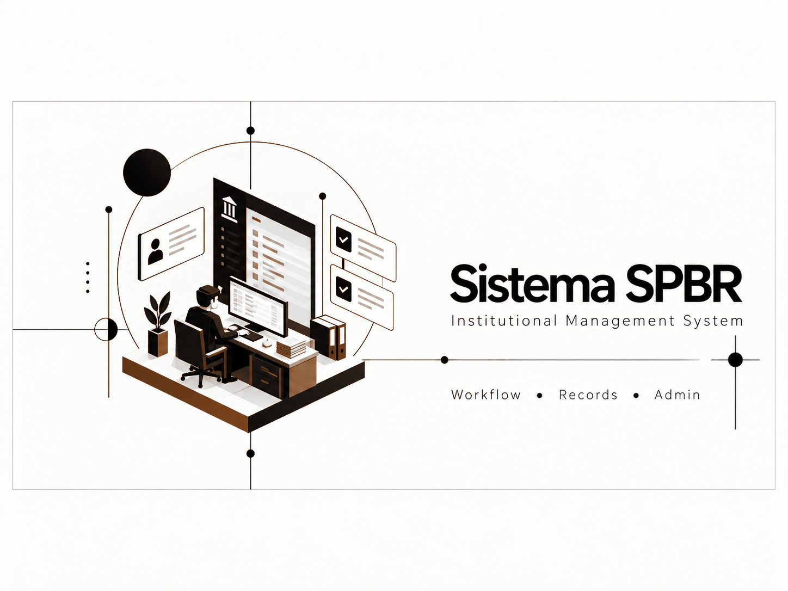

### An institutional operations system centered on controlled workflows, records, review states, and administration.

## Overview

Sistema SPBR organizes institutional records and recurring administrative processes in a single controlled workspace, emphasizing consistent status, responsibility, and traceability.

## My Contributions

- Translated administrative processes into explicit application workflows
- Designed record-centered navigation and review states
- Implemented role-aware operational views
- Improved traceability for recurring institutional work

## Project Highlights

- Institutional record management
- Workflow and review states
- Role-aware administration
- Operational traceability

## System Architecture

A layered web application separates the user-facing workflow, business rules, and persistent institutional records. Access and state transitions are governed centrally.

## Tech Stack

`Web application architecture` `Role-based access` `Relational data modeling` `Workflow automation` `Administrative dashboards`

## Results

- Consolidated recurring processes into a consistent interface
- Made record state and ownership easier to follow
- Reduced reliance on disconnected administrative artifacts

## Screenshots

Additional sanitized product screenshots will be added when they can be shared without exposing private data or infrastructure.

## What I Learned

Institutional software benefits from simple, visible state transitions and a durable history more than from adding isolated features.

## Privacy and Ownership

> Documentation-only portfolio presentation. The original source, institutional records, organization details, and deployment configuration are private.

## Contact

- [LinkedIn](https://www.linkedin.com/in/dev-ai-erick)
- [GitHub](https://github.com/DevDope)

---

This repository is maintained as a professional portfolio case study. No license to proprietary source code or private assets is granted.
